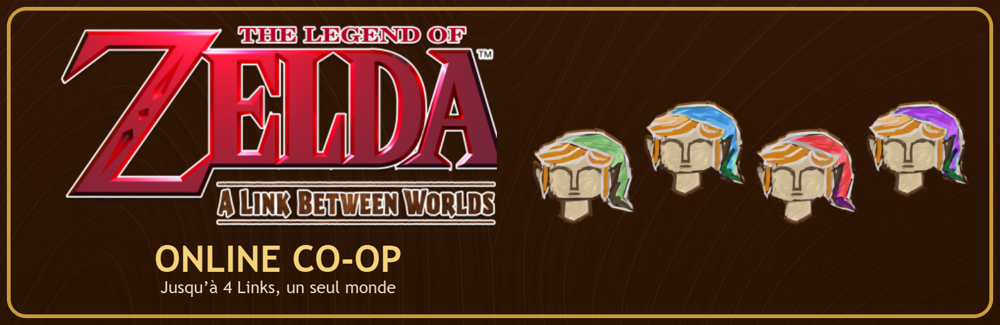
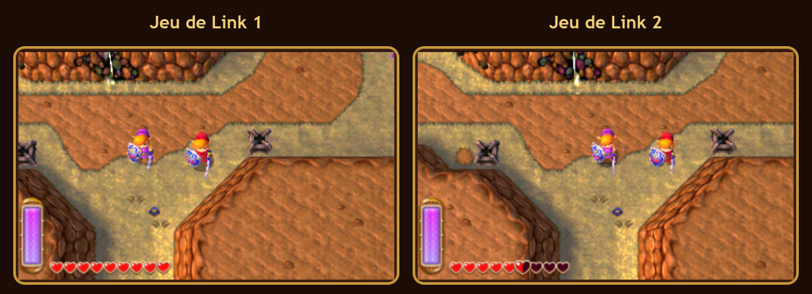
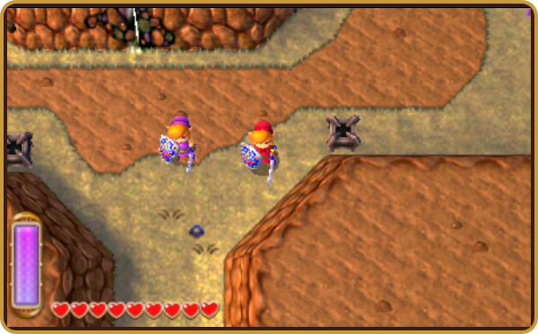
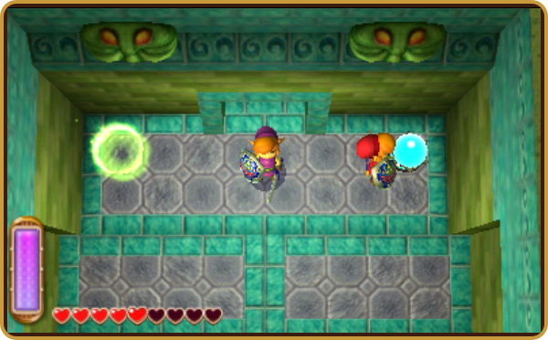
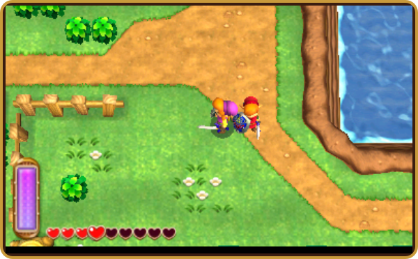

<p align="center">
  
</p>

<p align="center">
  
  
  
  
</p>

<p align="center">
  <b>Jouez à <i>The Legend of Zelda: A Link Between Worlds</i> à plusieurs, en ligne.</b><br>
  Chacun joue sa partie dans son Azahar ; vous vous voyez, vous vous aidez,<br>
  et ce que l'un fait dans le monde, les autres le voient aussi.
</p>

---

<p align="center">
  
  <br><sub>Deux jeux, un même monde : chacun voit l'autre Link, à la même place, avec sa couleur.</sub>
</p>

## ✨ Ce qui est partagé

<table>
  <tr>
    <td width="50%" valign="top">
      
      <h3>🧝 Les compagnons</h3>
      Les autres Links apparaissent dans votre jeu, en 3D : déplacements,
      animations, tunique <b>verte, bleue, rouge ou violette</b>, épée,
      bouclier, arc, grappin, bombes… et même la fusion en peinture sur les murs.
      Ils se bousculent doucement au lieu de se traverser.
    </td>
    <td width="50%" valign="top">
      
      <h3>🌍 Le monde</h3>
      Herbes, buissons, pots, rochers et panneaux coupés ou cassés chez tout le
      monde ; objets portés et lancés ; boules de cristal, boutons au sol et
      torches qui réagissent chez les deux.
    </td>
  </tr>
</table>

| | |
| --- | --- |
| ❤️ **Cœurs liés** | Une vie commune (option), et un HUD avec le pseudo et les cœurs de chacun. |
| ⚔️ **Ennemis** | Mêmes positions, mêmes points de vie, morts communes ; ils attaquent le joueur le plus proche. |
| 💎 **Butin** | Ce qui tombe est identique pour tous, et chacun reçoit sa part. |
| 🗝️ **Progression** | Coffres, objets reçus, portes, histoire : partagés (sauf les petites clés). |
| 💰 **Bourse commune** | Un achat chez Ravio coûte à tout le groupe. |
| 👻 **Mort partagée** | Un Link tombé suit ses compagnons en spectateur ; une girouette activée le ranime. Si tout le groupe tombe, retour ensemble à la dernière girouette (−15 % de rubis). |

## 📦 Ce qu'il faut

- **Windows 10 ou 11**
- **[Azahar](https://azahar-emu.org/)** 2126.2 ou plus récent (2125 et avant ne sont pas compatibles)
- **Votre copie** de *A Link Between Worlds*, **version européenne (EUR)** : la
  version américaine est reconnue, mais les fonctions avancées ne sont
  vérifiées que sur l'EUR
- **Python** : rien à faire, le lanceur l'installe tout seul s'il manque

## 🚀 Installation

1. **Téléchargez** le projet : bouton vert **Code → Download ZIP**, puis
   décompressez-le où vous voulez.
2. **Fermez Azahar**, puis **double-cliquez sur `run_coop.bat`.**

Au premier lancement, le lanceur installe ce qui manque (Python, PyQt6,
pygame), puis un écran d'accueil vérifie tout pour vous : Azahar, le jeu, la
liaison, la manette et le réseau. Il propose d'activer la liaison du compagnon
dans Azahar (serveur RPC et débogueur, onglet **Débogage**) : sans elle, ni
couleurs, ni amis affichés, ni monde partagé. Lancez ensuite toujours le jeu
depuis le lanceur.

## 🎮 Jouer en ligne

<table>
  <tr>
    <th width="50%">👑 L'hôte (un seul joueur)</th>
    <th width="50%">🤝 Les autres</th>
  </tr>
  <tr>
    <td valign="top">
      1. Lancez <code>run_coop.bat</code> → <b>Héberger un salon</b><br>
      2. Chargez votre sauvegarde et enregistrez à une girouette<br>
      3. Dans le menu coop (<b>F8 → Salon</b>), cliquez sur <b>Copier le code</b> : le <b>code de salon</b> (<code>ALBW-…</code>) est aussi écrit dans le journal<br>
      4. Envoyez ce code à vos amis et gardez le salon ouvert
    </td>
    <td valign="top">
      1. Lancez <code>run_coop.bat</code> → <b>Rejoindre un ami</b><br>
      2. Collez le code de salon de l'hôte (une adresse comme <code>192.168.1.24</code> marche aussi)<br>
      3. Choisissez de garder votre partie ou de <b>rejoindre avec la progression de l'hôte</b><br>
      4. Chargez le fichier choisi dans Azahar
    </td>
  </tr>
</table>

> [!TIP]
> **Pas sur le même réseau ? Rien à installer.** Le code de salon contient
> tous les chemins vers l'hôte : IPv6, adresse Internet vue par un serveur
> public STUN, ouverture UPnP de sa box et réseau local. Le compagnon de
> l'ami les essaie tous à la fois.
>
> Si la box de l'hôte bloque, l'ami voit un **code de réponse** dans son
> journal et dans **F8 → Salon** : il l'envoie à l'hôte, qui le colle dans
> **Code de réponse d'un ami → Ouvrir le passage**. Les deux PC s'envoient
> alors des paquets en même temps et les box les laissent passer (perçage de NAT).

Ça marche avec la grande majorité des box, et en 4G/5G dès que l'opérateur
fournit l'IPv6 (c'est le cas des principaux opérateurs français). Sans
serveur relais, un seul cas reste impossible : deux connexions IPv4 dont la
box change de port à chaque destination (le menu Salon le signale). Changez
alors d'hôte, ou utilisez un VPN comme Tailscale, toujours reconnu.
Autorisez Python dans le pare-feu Windows s'il le demande.

### Rejoindre avec la progression de l'hôte

Cette option utilise la **dernière sauvegarde enregistrée** du fichier que
l'hôte a chargé. Elle est proposée en rejoignant, et reste disponible dans
**F8 → Salon → Reprendre la progression de l'hôte…**.

1. Le téléchargement est vérifié avant utilisation ; les blocs perdus sont renvoyés.
2. Votre progression actuelle est copiée dans un dossier daté de **`backups/`**.
3. Vous choisissez **Fichier 1, 2 ou 3**. Seul ce fichier sera remplacé ;
   les autres fichiers et vos réglages de sauvegarde sont conservés.
4. Après votre confirmation, **votre Azahar se ferme proprement puis se rouvre**.
   Enregistrez votre partie avant de confirmer. Chargez ensuite le fichier choisi.

Vous pouvez annuler avant l'import. La sauvegarde de l'hôte reste intacte.
Cette opération nécessite ALBW **EUR** et les données de sauvegarde créées
par un premier lancement du jeu dans votre Azahar.

> [!IMPORTANT]
> Chacun garde sa propre sauvegarde. L'import est facultatif ; sans lui,
> commencez au même point de l'histoire pour que tout corresponde.
> Tous les joueurs doivent avoir la **même version** du mod : le salon refuse
> une version différente et indique qui doit se mettre à jour.

Le menu **Salon** affiche la latence et les pertes estimées à partir des
sondes de connexion. Une coupure déclenche une reconnexion automatique ;
laissez l'hôte ouvert pour retrouver la même session.

### Mettre le mod à jour

Au lancement de **`run_coop.bat`**, une vérification rapide sur GitHub affiche
les nouveautés et propose **« Installer maintenant ? [O/n] »** lorsqu'une
nouvelle version est disponible. Appuyez sur **Entrée** pour télécharger et
relancer ; **N** pour continuer. Si un jeu est encore ouvert avec le compagnon,
fermez Azahar puis appuyez sur Entrée pour réessayer.

Les réglages et parties de **`.local/`**, l'environnement **`.venv/`** et les
copies de **`backups/`** sont conservés. Les composants sont réinstallés si nécessaire.
Sans Internet ou si GitHub ne répond pas, le lancement continue normalement.
Les copies de développement et les copies Git modifiées à la main ne sont pas remplacées.

## 🧪 Essayer à deux sur un seul PC

Double-cliquez sur **`test_local_coop.bat`**, puis **Lancer Link 1** et
**Lancer Link 2** : les deux fenêtres se placent côte à côte et se connectent
toutes seules. Chaque copie a ses propres sauvegardes de test ; votre
installation d'Azahar n'est pas modifiée.

## ⌨️ Pendant la partie

| Touche | Action |
| :---: | --- |
| <kbd>F8</kbd> | Ouvrir ou fermer le menu coop |
| <kbd>Échap</kbd> | Fermer le menu et revenir au jeu |
| <kbd>L3</kbd> + <kbd>R3</kbd> | Ouvrir le menu à la manette (modifiable) |

Dans le menu, à la manette :

| Bouton | Action |
| :---: | --- |
| Croix directionnelle ou stick gauche | Passer d'un élément à l'autre (maintenir pour aller vite) |
| <kbd>←</kbd> <kbd>→</kbd> | Régler un curseur, le port ou une liste |
| <kbd>L1</kbd> / <kbd>R1</kbd> (ou <kbd>L2</kbd> / <kbd>R2</kbd>) | Page précédente / suivante |
| Stick droit | Faire défiler la page ou le journal |
| <kbd>Croix</kbd> / <kbd>A</kbd> | Valider |
| <kbd>Rond</kbd> / <kbd>B</kbd> | Fermer le menu |

Tant que le menu est ouvert, la partie ignore la manette : Link reste sur
place au lieu de marcher ou de lever le bouclier derrière le menu.

Le menu regroupe votre pseudo et votre couleur de tunique, le salon, la liste
des compagnons, le journal de la session et les réglages du HUD.

<p align="center">
  
</p>

## 🛠️ En cas de souci

<details>
<summary><b>Azahar est détecté, mais pas de cœurs</b></summary>

Chargez une sauvegarde : le compagnon attend une vraie partie, pas l'écran
titre.
</details>

<details>
<summary><b>« Azahar trop ancien » ou « Serveur RPC incompatible »</b></summary>

Le compagnon lit le jeu par le serveur RPC d'Azahar 2126. Azahar 2125 et avant
répondent avec une autre version de ce protocole : installez
[Azahar 2126.2](https://github.com/azahar-emu/azahar/releases/latest), puis
relancez `run_coop.bat`.
</details>

<details>
<summary><b>Rien ne se connecte</b></summary>

Vérifiez que l'écran d'accueil indique la liaison active et que le code de
salon a été copié en entier. Si l'ami attend sans entrer, envoyez son
<b>code de réponse</b> à l'hôte, qui le colle dans <b>F8 → Salon</b> et clique
sur <b>Ouvrir le passage</b> dans les 45 secondes. Si le menu Salon signale une
box qui change de port, essayez avec l'autre joueur comme hôte. Un code
change quand la box redémarre : recopiez-le avant chaque partie. Regardez
aussi le pare-feu Windows de l'hôte.
</details>

<details>
<summary><b>Un ami ne voit pas les mêmes choses</b></summary>

Vérifiez que vous avez tous la même version du projet, la version EUR du jeu,
et des sauvegardes au même point de l'histoire.
Le bouton <b>Reprendre la progression de l'hôte…</b> permet de repartir de sa
dernière sauvegarde, après une copie de secours de votre partie.
</details>

<details>
<summary><b>On me dit que les versions sont différentes</b></summary>

Le message affiche les deux versions et indique qui doit se mettre à jour.
Fermez normalement le compagnon concerné puis relancez <code>run_coop.bat</code>
et acceptez la mise à jour. Le numéro utilisé par le salon se trouve dans
<code>VERSION</code> à la racine du projet.
</details>

<details>
<summary><b>Comment retrouver ma progression après un import ?</b></summary>

La fenêtre d'import indique le dossier daté sous <code>backups/</code> qui
contient vos trois fichiers et <code>SaveCommon.bin</code>. Conservez-le.
Pour une restauration manuelle, fermez d'abord Azahar et le compagnon, puis
remettez ces fichiers dans le dossier de sauvegarde indiqué dans
<code>verification.json</code>. Ne le faites jamais pendant qu'un Azahar
utilisant ce dossier est ouvert.
</details>

<details>
<summary><b>La liaison se coupe ou le compagnon saccade</b></summary>

Le mod tente de se reconnecter tout seul. Gardez le salon de l'hôte ouvert et
attendez quelques secondes. Regardez la latence et les pertes dans
<b>F8 → Salon</b> ; essayez une connexion filaire et interrompez les gros
téléchargements. Si le salon est fermé puis recréé, il s'agit d'une nouvelle session.
</details>

<details>
<summary><b>La mise à jour ne se propose pas ou échoue</b></summary>

Hors ligne, le jeu continue avec la version installée. Réessayez plus tard
avec Internet. Une copie de développement ou une copie Git modifiée est laissée
intacte : téléchargez alors un nouveau ZIP dans un autre dossier. Si une
installation échoue, les anciens fichiers sont restaurés.
</details>

<details>
<summary><b>Je suis connecté, mais Link reste vert et mon ami est invisible</b></summary>

Vérifiez la version EUR du jeu et la liaison active sur l'écran d'accueil.
À partir de la version <b>0.4.1</b>, une réponse locale perdue est vérifiée
avant d'interrompre le rendu ; les appels déjà exécutés ne sont pas relancés.
Un premier chargement ou la compilation des graphismes peut le retarder.
Après mise à jour depuis une version qui restait bloquée, enregistrez puis
fermez normalement Azahar et le compagnon avant de relancer
<code>run_coop.bat</code>. Si le problème continue, copiez le journal avec
<b>F8 → Journal → Copier</b> : il contient l'état des services.
</details>

<details>
<summary><b>L'interface disparaît en plein écran sur mon autre écran</b></summary>

La version <b>0.4.1</b> suit l'échelle du moniteur qui affiche Azahar,
y compris si les deux écrans n'ont pas le même agrandissement Windows.
Le HUD est maintenu au-dessus du jeu sans lui retirer le focus.
Si votre mode plein écran le masque encore, repassez temporairement en
fenêtre et indiquez les résolutions et les agrandissements des deux écrans.
</details>

Le **journal** du menu coop explique ce qui se passe et peut être copié pour
signaler un problème.

### Envoyer un rapport

**F8 → Journal → Créer un rapport**, ou **Créer un rapport** sur l'écran
d'accueil si le menu ne s'ouvre pas, dépose un fichier
`rapport-albw-coop-….zip` sur le Bureau et ouvre son dossier. Envoyez ce
fichier au développeur : il contient les versions du mod et d'Azahar, les
réglages utiles d'Azahar, les écrans, les journaux du compagnon, le journal
d'Azahar et les plantages notés par Windows. Rien n'est envoyé tout seul. Le
dossier utilisateur Windows y est masqué et le compte en ligne d'Azahar n'est
jamais lu ; les codes de salon et adresses restent, pour diagnostiquer la
connexion.

## 🔧 Pour les développeurs

[ARCHITECTURE.md](ARCHITECTURE.md) explique comment tout fonctionne. Le code
injecté dans le jeu est écrit en assembleur ARM (`src/memory/*.arm`) ; après
une modification, reconstruisez-le :

```powershell
.\.venv\Scripts\python.exe -m pip install -r requirements-dev.txt
.\.venv\Scripts\python.exe -m scripts.build_remote_model
```

## ⚖️ Mentions

*The Legend of Zelda* et *A Link Between Worlds* sont des marques de Nintendo.
Ce projet de fan n'est ni affilié à Nintendo ni approuvé par Nintendo. Il ne
contient ni le jeu ni son code ; seules quelques images de l'interface
(`assets/`) viennent des textures du jeu et restent la propriété de Nintendo.
